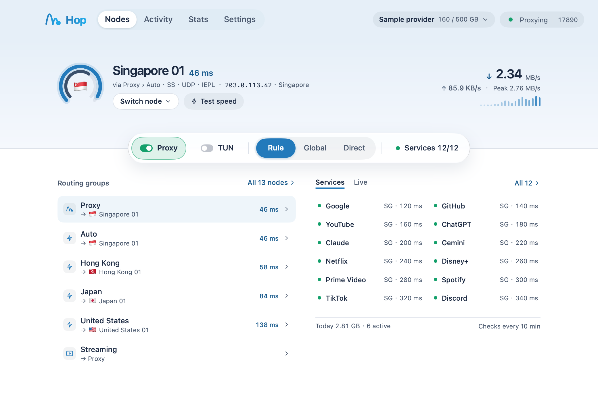
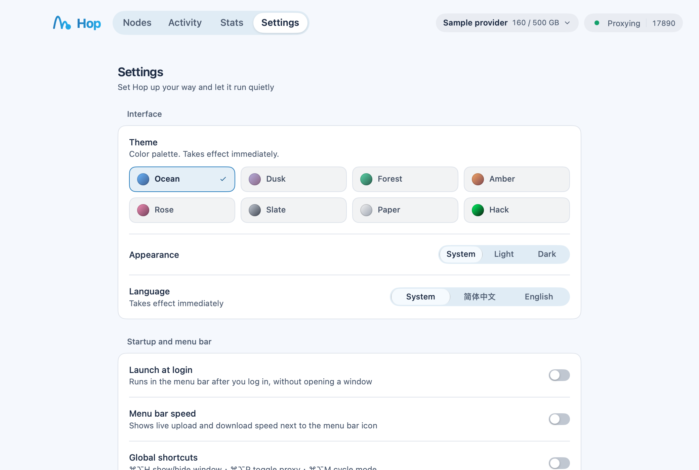
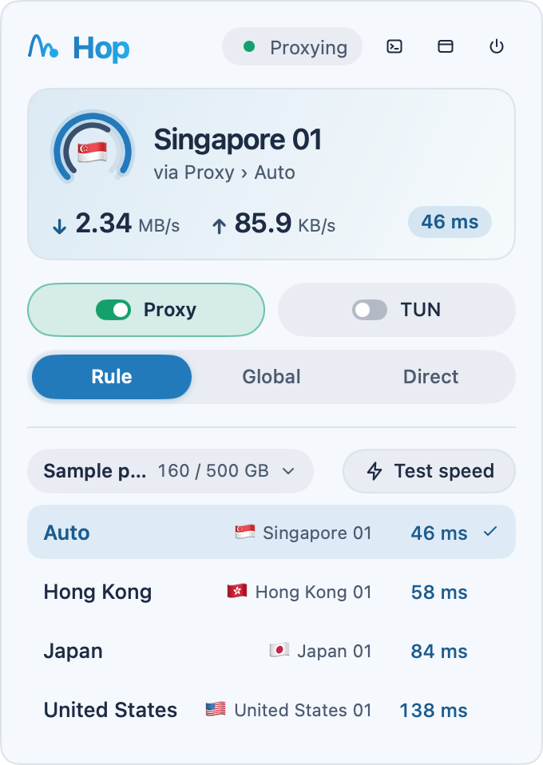
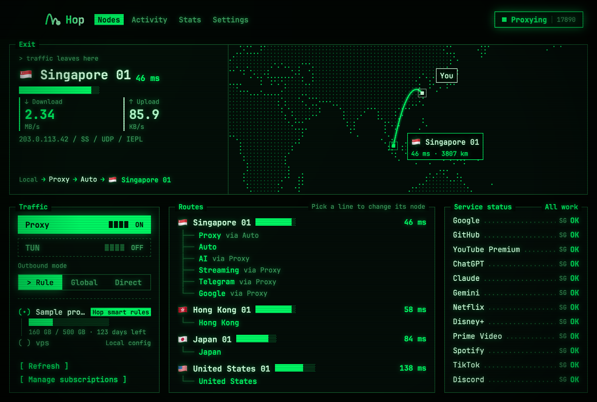
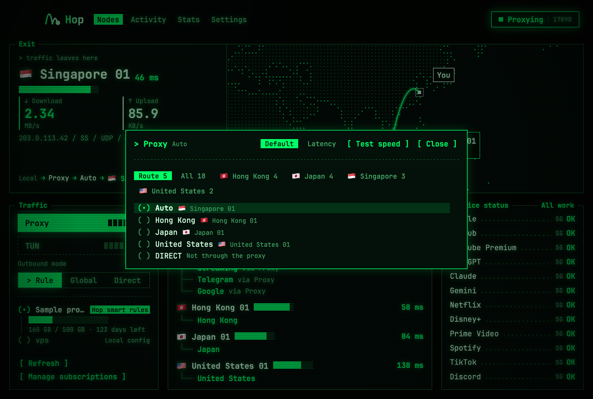
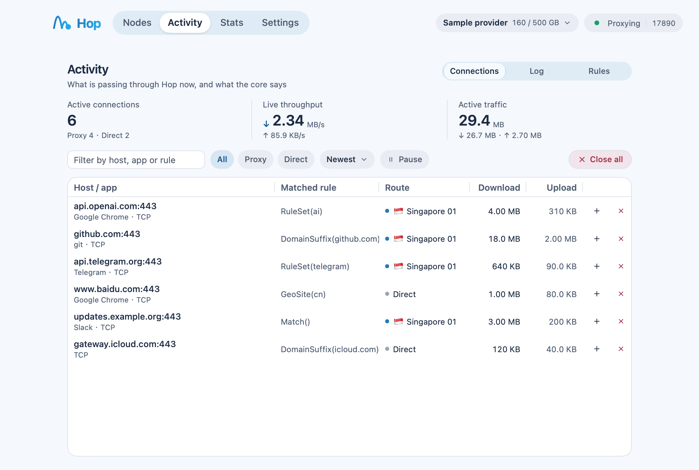
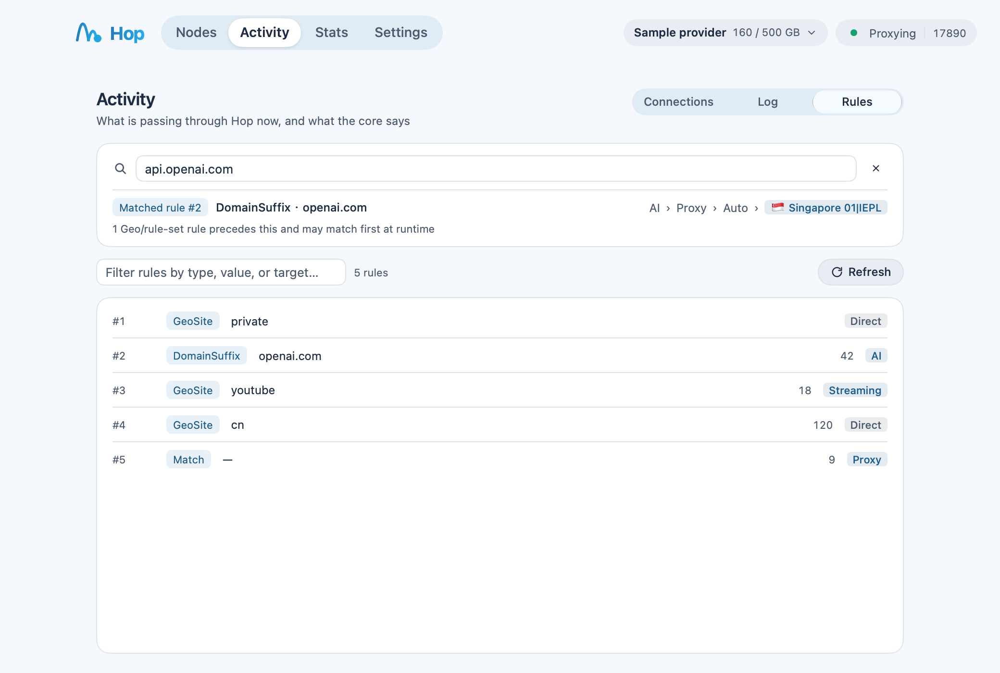
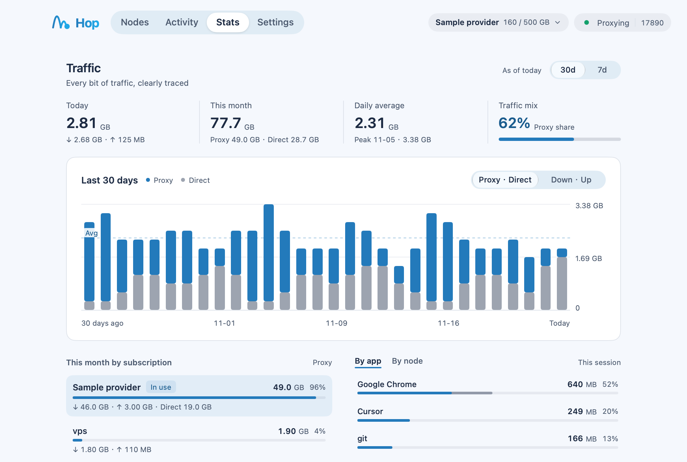

<p align="center">
  
</p>

<h1 align="center">Hop</h1>

<p align="center">
  A quiet, native macOS and Windows proxy client for <a href="https://github.com/MetaCubeX/mihomo">mihomo</a>, built in Go with <a href="https://github.com/egoist/mygo">MyGo</a> — no webview.
</p>

<p align="center">
  <a href="README.md">简体中文</a> · <strong>English</strong>
</p>

<p align="center">
  <a href="https://github.com/marukolibro/Hop/releases/latest"></a>
  <a href="https://github.com/marukolibro/Hop/actions/workflows/ci.yml"></a>
  <a href="LICENSE"></a>
  <a href="go.mod"></a>
  
  <a href="https://github.com/MetaCubeX/mihomo"></a>
  <a href="https://github.com/egoist/mygo"></a>
  <a href="https://awesomemygo.dev/apps/hop"></a>
</p>

<p align="center">
  <picture>
    <source media="(prefers-color-scheme: dark)" srcset="docs/screenshots/en/nodes-dark.png">
    
  </picture>
</p>

<p align="center">
  <a href="#install">Install</a> ·
  <a href="#features">Features</a> ·
  <a href="#usage-guide">Usage guide</a> ·
  <a href="#privacy--safety">Privacy &amp; safety</a> ·
  <a href="#faq">FAQ</a> ·
  <a href="#development">Development</a>
</p>

---

Hop is a native desktop client for the [mihomo](https://github.com/MetaCubeX/mihomo) (Clash.Meta) core. Its UI is rendered natively in Go with [MyGo](https://github.com/egoist/mygo) without bundling a browser engine, running from a single codebase on macOS and Windows. Hop does not provide servers — bring your own subscription or node links.

> Built-in **Simplified Chinese** and **English** UI. Follows your system language by default and switches instantly under **Settings → Language**.

## Install

| Platform | Requirements | How to install |
| --- | --- | --- |
| **macOS** | Apple silicon / Intel (universal binary) | Run the shell script below |
| **Windows** | Windows 10 / 11 x64 (glass needs Win11 22H2+) | Run the PowerShell script, or download the installer from [Releases](https://github.com/marukolibro/Hop/releases/latest) |

> Linux is not supported.

### macOS

```sh
curl -fsSL https://github.com/marukolibro/Hop/releases/latest/download/install.sh | sh
```

Installs into `/Applications` (or `~/Applications`) without `sudo`, verifying file size and Ed25519 signature before launching. Run again to update; `sh install.sh --uninstall` removes the app while keeping your data.

> macOS builds are currently ad hoc signed, so installing via the script rather than opening a downloaded `.dmg` lets macOS launch Hop cleanly.

### Windows

```powershell
irm https://github.com/marukolibro/Hop/releases/latest/download/install.ps1 | iex
```

Verifies `SHA256SUMS` and installs silently for the current user (no admin rights). Or download `hop-setup-<version>-amd64.exe` from the [latest release](https://github.com/marukolibro/Hop/releases/latest) (choose **More info → Run anyway** on the first SmartScreen prompt).

Once installed, Hop checks for and applies signed in-app updates through its own proxy.

---

## Features

### Native UI & themes

- **Everything at a glance**: Active exit node, live throughput gauge, public exit IP (click to copy), floating control dock (System Proxy / TUN / Outbound Mode), routing groups, and 12 live service health checks in one clean window.
- **8 instant themes**: 6 native glass themes (**Ocean, Dusk, Forest, Amber, Rose, Slate** — each with light/dark palettes and dedicated accents), calm matte **Paper**, and phosphor-green **Hack** terminal mode. macOS includes a window transparency slider.
- **Menu bar & tray panel**: Switch subscriptions, nodes, modes, and proxy switches without opening the main window, with optional live speed in the macOS menu bar.

<p align="center">
  <picture>
    <source media="(prefers-color-scheme: dark)" srcset="docs/screenshots/en/settings-dark.png">
    
  </picture>
  &nbsp;
  <picture>
    <source media="(prefers-color-scheme: dark)" srcset="docs/screenshots/en/menubar-dark.png">
    
  </picture>
</p>

<details>
<summary>Preview the Hack terminal theme</summary>
<p align="center">
  
  &nbsp;
  
</p>
</details>

### Nodes, subscriptions & routing

- **Multiple subscriptions & local profiles**: Supports Clash YAML and plain node links (ss / vmess / vless / trojan / hysteria2 / tuic / anytls, etc.), parsed locally with mihomo's own converter. Supports scheduled refresh and stored local copies for self-hosted VPS setups.
- **Smart rules out of the box**: Choose per subscription between provider rules or **Hop smart rules** (AI, streaming, Telegram, Google, Apple, Microsoft, and regional groups, China-direct routing, weekly auto-updating geodata).
- **Fast node switching**: Filter by region, sort by latency, hide timed-out nodes, pick fastest in one click, run parallel group tests or single-node probes, and pin/reset `URLTest` or `Fallback` groups. Selected nodes persist across restarts.
- **Automatic recovery**: Listens for system wake and network changes to flush core DNS cache and refresh routes automatically.

### Activity inspector & statistics

- **Live connections**: Inspect app, matched rule, route, and throughput per connection; filter, sort (newest / traffic / host), **pause live refresh**, close single or **filtered connections**, or create a rule in two clicks.
- **Rules diagnosis & logs**: Browse every active rule with hit counts, test any domain or IP offline to see its exact matched rule and exit chain, refresh external proxy/rule providers, and inspect live logs or open `hop.log`.
- **Traffic statistics**: 7-day / 30-day charts (Proxy · Direct or Download · Upload), monthly per-subscription totals, and in-memory session rankings by app and node.

<p align="center">
  <picture>
    <source media="(prefers-color-scheme: dark)" srcset="docs/screenshots/en/connections-dark.png">
    
  </picture>
  &nbsp;
  <picture>
    <source media="(prefers-color-scheme: dark)" srcset="docs/screenshots/en/activity-rules-dark.png">
    
  </picture>
</p>

<p align="center">
  <picture>
    <source media="(prefers-color-scheme: dark)" srcset="docs/screenshots/en/stats-dark.png">
    
  </picture>
</p>

---

## Usage guide

### 1. Add a subscription

Three ways to import a profile:

1. **Subscription URL**: Click the subscription pill in the header → Add subscription and paste your link.
2. **Local config**: Switch source to **Local config** to paste node links / Clash YAML or pick a local file (stored as an independent copy).
3. **One-click browser import**: Hop registers `clash://`, `mihomo://`, and `hop://` URL schemes. Opening a link focuses Hop and pre-fills the dialog (nothing is downloaded until you confirm):
   ```text
   clash://install-config?url=<encoded_subscription_url>&name=<optional_name>
   ```

### 2. Traffic capture & shortcuts

- **System proxy**: Toggle from the floating dock for browsers and desktop apps; customize extra bypass domains, wildcards, or CIDRs in **Settings → Network → System proxy bypass list**.
- **Terminal proxy**: Copy the shell export command from the menu bar header or **Settings → Network → Terminal proxy** (default mixed port `127.0.0.1:17890`, configurable live).
- **TUN mode**: Captures all system traffic including terminals and games. Prompts once to install a lightweight privileged helper (macOS LaunchDaemon / Windows service); afterwards, toggling TUN reloads the same core without dropping ports, and the helper can be uninstalled anytime in Settings.
- **LAN access**: Enable in **Settings → LAN** to share the HTTP / SOCKS5 proxy with private-network devices (random username/password required by default).
- **Global shortcuts** (off by default, enable in **Settings → Startup and menu bar**):

| Action | macOS | Windows |
| --- | --- | --- |
| Show / hide main window | `⌘⌥H` | `Ctrl+Alt+H` |
| Toggle system proxy | `⌘⌥P` | `Ctrl+Alt+P` |
| Cycle outbound mode | `⌘⌥M` | `Ctrl+Alt+M` |

### 3. Custom rules & JSON backup

Custom rules run ahead of all subscription rules. Manage them in **Settings → Custom rules**, or click **+** on any row in **Activity → Connections**.

- Supported types: `DOMAIN-SUFFIX`, `DOMAIN`, `DOMAIN-KEYWORD`, `IP-CIDR`, `PROCESS-NAME`.
- Targets: `DIRECT`, `PROXY`, `REJECT`, or **any named policy group** in your active profile.
- Supports in-place editing, enable/disable toggles, reordering, and automatic closing of affected active connections so changes apply immediately.

Use **Export** and **Import** in **Settings → Custom rules** to back up or sync rules as JSON. Both the versioned object format below and a plain JSON array `[...]` are supported:

```json
{
  "version": 1,
  "rules": [
    {
      "type": "DOMAIN-SUFFIX",
      "value": "openai.com",
      "target": "AI"
    },
    {
      "type": "DOMAIN",
      "value": "api.example.com",
      "target": "PROXY"
    },
    {
      "type": "DOMAIN-KEYWORD",
      "value": "internal",
      "target": "DIRECT"
    },
    {
      "type": "IP-CIDR",
      "value": "192.0.2.0/24",
      "target": "DIRECT"
    },
    {
      "type": "PROCESS-NAME",
      "value": "Telegram",
      "target": "PROXY",
      "disabled": true
    }
  ]
}
```

- **Safe merge**: Importing preserves existing rules. Entries match case-insensitively by `(type, value)` — matching rules update in place, new rules append in order, and everything is validated before reloading the core.
- **Missing group fallback**: If a rule targets a policy group absent in the current subscription, Hop routes it through the main proxy group with a warning instead of failing reload.

---

## Privacy & safety

- **Never disturbs other clients**: Never reads, writes, or kills other Clash clients; refuses to take over an occupied system proxy or TUN route, and restores its own changes on quit.
- **Credentials stay private**: Subscription URLs and local configs (with node passwords) are never logged or leaked in errors; node links convert strictly on-device.
- **Strict config whitelist**: Only proxies, groups, rules, and essential node-server DNS entries are taken from subscriptions — Hop always owns ports, controller, TUN, and LAN boundaries.
- **Loopback by default**: Listens only on `127.0.0.1` unless LAN access is turned on; even then, controller and core DNS remain loopback-only.
- **No browsing history on disk**: `hop.log` records only Hop logs and core warnings/errors (never connection hosts); exit IP is queried once via `1.1.1.1/cdn-cgi/trace` through Hop's proxy and kept strictly in memory.

---

## FAQ

- **macOS says Hop is damaged or from an unidentified developer?**
  Install using the `install.sh` script above instead of opening a manually downloaded `.dmg`.
- **TUN won't turn on?**
  Another VPN or proxy client holds the default routes. Turn off its TUN first; Hop never steals routes.
- **An app can't connect under TUN (e.g. Tailscale)?**
  TUN answers DNS with Fake-IPs (`198.18.x.x`). Add the domain under **Settings → TUN → Fake-IP exceptions** (`example.com`, `*.example.com`, or `+.example.com`) to return real IPs without changing routes.
- **Port conflict with another app?**
  Default ports (`17890` / `19090` / `17853`) already avoid other Clash clients, and the mixed port can be changed live in **Settings → Network → Proxy port**.
- **Does Hop support merge scripts?**
  No, by design — Hop keeps configuration predictable using built-in smart rules and custom rules.

---

## Development

### Architecture & default paths

```text
Hop (MyGo native UI) ── REST / WebSocket ──▶ mihomo core (127.0.0.1)
       │                                            ▲
       └── privileged helper (after TUN setup) ─────┘ owns the core, seamless TUN reload
```

| Item | Release default | Dev build (`mygo dev`) |
| --- | --- | --- |
| Mixed proxy (HTTP + SOCKS5) | `127.0.0.1:17890` | `127.0.0.1:17892` |
| Core controller | `127.0.0.1:19090` | `127.0.0.1:19092` |
| Core DNS (when needed) | `127.0.0.1:17853` | `127.0.0.1:17855` |
| Data directory (`0600`) | macOS: `~/Library/Application Support/hop/`<br>Windows: `%AppData%\hop` | `hop-dev` (isolated, never touches helper) |

### Run & test locally

Requires **Go 1.27.3** or later:

```sh
scripts/fetch-mihomo.sh darwin-arm64   # fetch pinned, hash-checked core & geodata
scripts/build-helper.sh darwin-arm64   # build privileged TUN helper

go tool mygo dev                       # live-reload dev build
go vet ./... && go tool mygo vet .
TMPDIR=/tmp HOP_MIHOMO_BINARY="$PWD/resources/darwin-arm64/bin/mihomo" go test ./...
```

On Windows, pass `windows-amd64` to both scripts (in Git Bash) and point `HOP_MIHOMO_BINARY` to `mihomo.exe`. Cross-compile with `go tool mygo build -platform windows/amd64`.

### Project layout

```text
main.go               entry point & wiring
config/               release/dev instance ports, data dirs, core resolution
cmd/hop-helper/       privileged TUN helper
internal/handler/     MyGo native UI
internal/service/     business logic (views, subscriptions, rules, deep links, TUN, updates)
internal/repository/  mihomo process/client, storage, helper IPC, system proxy & routes
internal/model/       shared types
locales/              zh-Hans / en message catalogs & generated accessors
scripts/              core fetch, helper build, release, and TUN diagnostics
```

See [AGENTS.md](AGENTS.md) for architecture rules and contributor guidelines.

### Releasing

Bump `version` in `mygo.json`, add a section to `CHANGELOG.md`, commit, and push a tag:

```sh
git tag v0.6.0 && git push origin v0.6.0
```

The [release workflow](.github/workflows/release.yml) builds and signs macOS universal and Windows installers and uploads them to a draft release for review.

---

## License

Hop is licensed under [GPL-3.0](LICENSE). The bundled mihomo core is also GPL-3.0, and geodata comes from [MetaCubeX/meta-rules-dat](https://github.com/MetaCubeX/meta-rules-dat).
