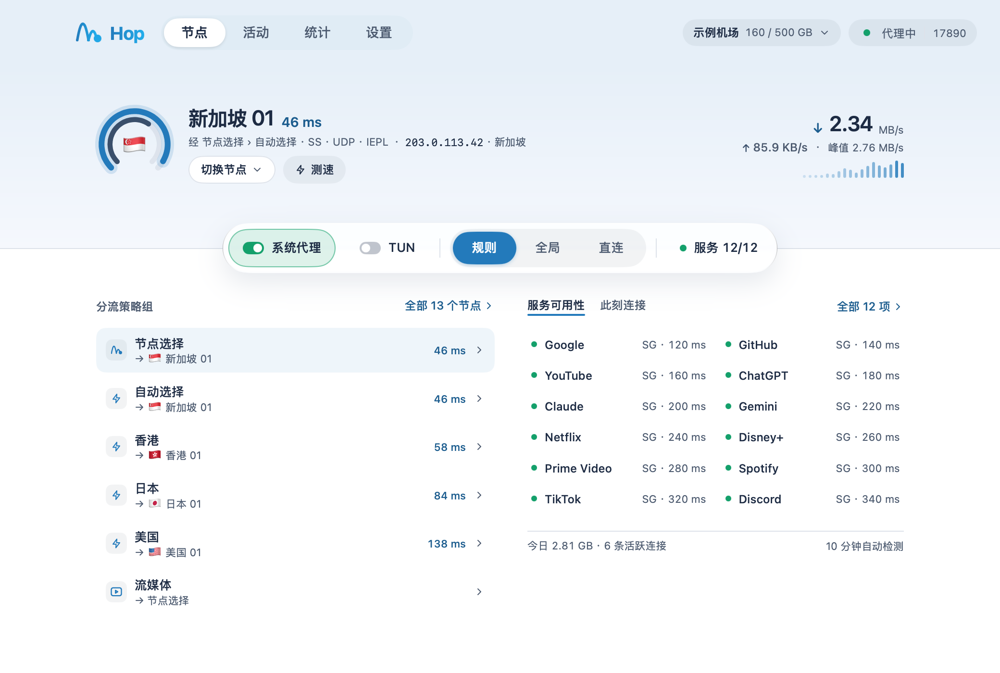
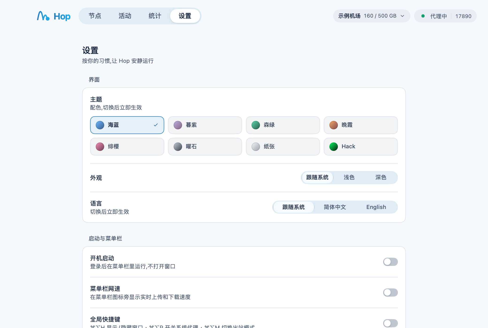
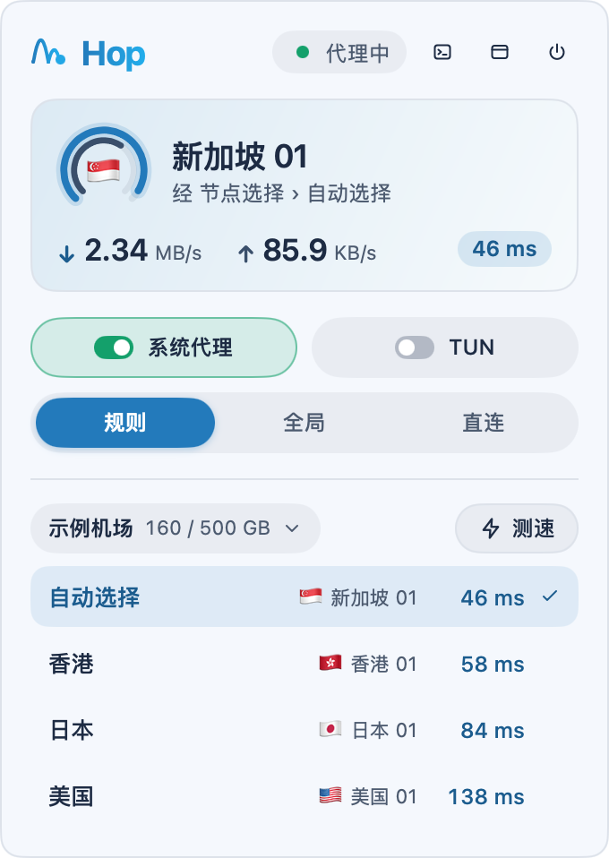
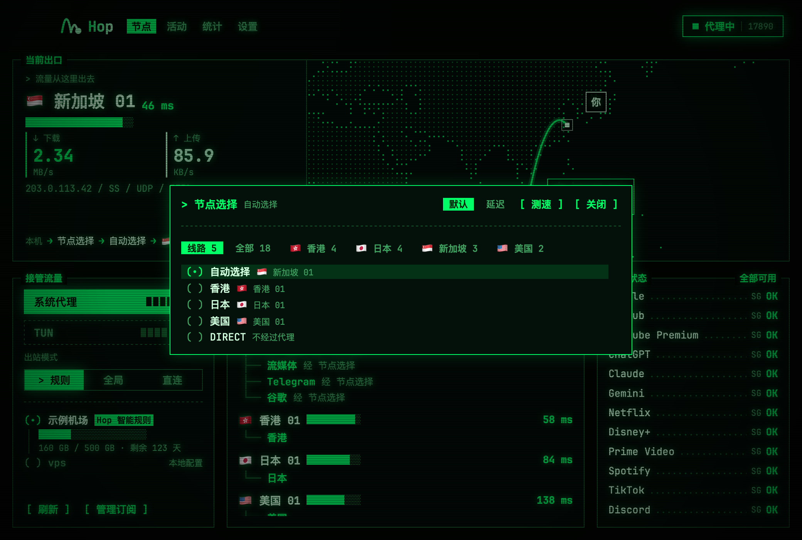
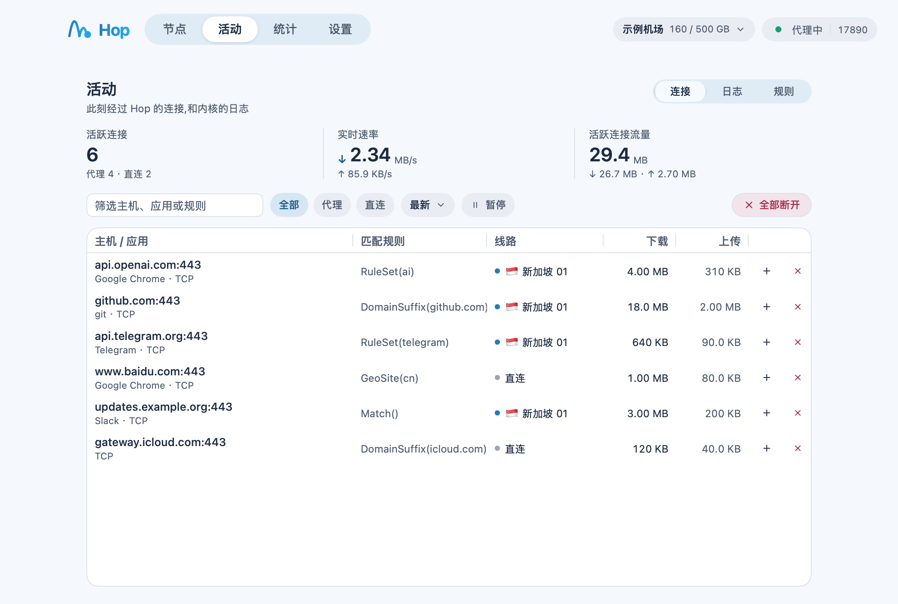
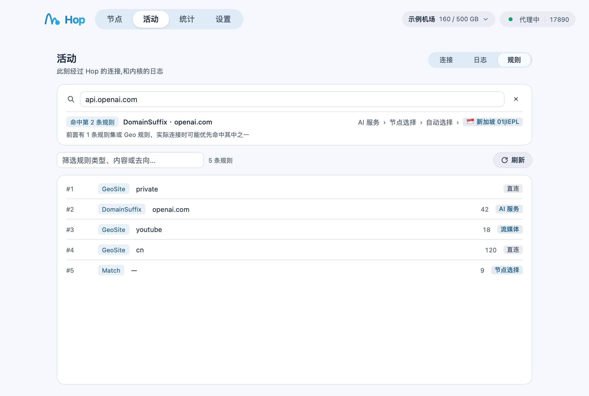
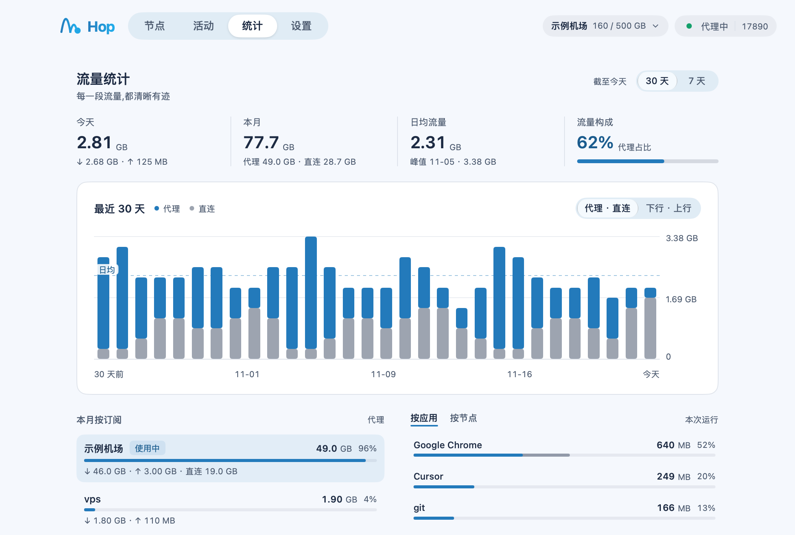

<p align="center">
  
</p>

<h1 align="center">Hop</h1>

<p align="center">
  轻量、安静的 macOS / Windows 原生代理客户端，基于 <a href="https://github.com/MetaCubeX/mihomo">mihomo</a> 内核与 <a href="https://github.com/egoist/mygo">MyGo</a> 原生绘制，无 webview。
</p>

<p align="center">
  <strong>简体中文</strong> · <a href="README-en.md">English</a>
</p>

<p align="center">
  <a href="https://github.com/marukolibro/Hop/releases/latest"></a>
  <a href="https://github.com/marukolibro/Hop/actions/workflows/ci.yml"></a>
  <a href="LICENSE"></a>
  <a href="go.mod"></a>
  
  <a href="https://github.com/MetaCubeX/mihomo"></a>
  <a href="https://github.com/egoist/mygo"></a>
  <a href="https://awesomemygo.dev/apps/hop"></a>
</p>

<p align="center">
  <picture>
    <source media="(prefers-color-scheme: dark)" srcset="docs/screenshots/nodes-dark.png">
    
  </picture>
</p>

<p align="center">
  <a href="#安装">安装</a> ·
  <a href="#特性">特性</a> ·
  <a href="#使用指南">使用指南</a> ·
  <a href="#隐私与安全">隐私与安全</a> ·
  <a href="#常见问题">常见问题</a> ·
  <a href="#开发与构建">开发与构建</a>
</p>

---

Hop 是一个专注日常使用体验的 [mihomo](https://github.com/MetaCubeX/mihomo)（Clash.Meta）桌面客户端。整个界面用 Go 和 [MyGo](https://github.com/egoist/mygo) 原生渲染，不打包浏览器内核，启动快、占用低，macOS 与 Windows 共享同一套实现。Hop 本身不提供任何节点服务，你需要自带订阅或配置。

> 界面内置**简体中文**与 **English**，默认跟随系统语言，可在 **设置 → 语言** 中即时切换。

## 安装

| 平台 | 系统要求 | 安装方式 |
| --- | --- | --- |
| **macOS** | Apple Silicon / Intel（通用应用） | 终端执行下方脚本 |
| **Windows** | Windows 10 / 11 x64（毛玻璃需 Win11 22H2+） | PowerShell 脚本，或从 [Releases](https://github.com/marukolibro/Hop/releases/latest) 下载安装包 |

> 暂不支持 Linux。

### macOS

```sh
curl -fsSL https://github.com/marukolibro/Hop/releases/latest/download/install.sh | sh
```

无需 `sudo`，脚本会自动校验文件大小与 Ed25519 签名并安装到 `/Applications`（或 `~/Applications`）。再次运行即可更新；卸载可执行 `sh install.sh --uninstall`（保留个人数据）。

> 目前 macOS 包采用本机临时签名（ad hoc），请通过上述脚本安装而非直接打开下载的 `.dmg`。

### Windows

```powershell
irm https://github.com/marukolibro/Hop/releases/latest/download/install.ps1 | iex
```

脚本会校验 `SHA256SUMS` 并以当前用户静默安装（无需管理员权限）。也可手动下载 [最新 Release](https://github.com/marukolibro/Hop/releases/latest) 中的 `hop-setup-<version>-amd64.exe`；首次运行若触发 SmartScreen 提示，点击 **更多信息 → 仍要运行**。

安装后，Hop 支持在应用内通过自身代理检查并安装带签名的版本更新。

---

## 特性

### 原生界面与多主题

- **一眼看清状态**：主界面集中呈现当前出口节点、实时速率与出口 IP（点击复制）、悬浮控制条（系统代理 / TUN / 出站模式）、策略组与 12 项常用服务可用性检测。
- **8 套主题即时切换**：提供 **海蓝、暮紫、森绿、晚霞、绯樱、曜石** 6 套原生玻璃主题（均含浅色 / 深色与独立强调色）、极简 **纸张** 主题，以及复古荧光绿终端风 **Hack** 主题；macOS 支持滑动调节窗口通透度。
- **菜单栏 / 托盘浮窗**：不用打开主窗口即可切换订阅、节点、模式与代理开关，macOS 菜单栏可选显示实时网速。

<p align="center">
  <picture>
    <source media="(prefers-color-scheme: dark)" srcset="docs/screenshots/settings-dark.png">
    
  </picture>
  &nbsp;
  <picture>
    <source media="(prefers-color-scheme: dark)" srcset="docs/screenshots/menubar-dark.png">
    
  </picture>
</p>

<details>
<summary>查看 Hack 终端主题截图</summary>
<p align="center">
  
  &nbsp;
  
</p>
</details>

### 节点、订阅与分流

- **多订阅与本地配置**：支持 Clash YAML 及常见节点链接（ss / vmess / vless / trojan / hysteria2 / tuic / anytls 等），节点链接在本地解析，不经过第三方转换服务；支持定时自动更新与本地文件副本（适合自建 VPS）。
- **智能规则开箱即用**：每份订阅可自由选择沿用机场规则，或切换为内置 **Hop 智能规则**（AI、流媒体、Telegram、Google、Apple、Microsoft 及地区自动分组，国内直连，规则库每周自动更新）。
- **高效的节点选择**：支持按地区筛选、按延迟排序、隐藏超时节点、一键选最快、并发测速与单节点点测；自动优选组（`URLTest` / `Fallback`）支持手动固定节点及一键恢复自动；选中的节点重启后保持不变。
- **断网与休眠自恢复**：监听系统唤醒与网络切换，自动清理内核 DNS 缓存并刷新状态。

### 活动监测与流量统计

- **实时连接**：查看每条连接的进程、命中规则、出口与流量；支持筛选、排序（最新 / 流量 / 主机）、**暂停刷新**、单条或**按筛选批量断开**，以及一键从连接生成规则。
- **规则诊断与日志**：查看全部生效规则与命中次数，输入域名或 IP 离线排查命中的规则和出口链；支持刷新外部节点集 / 规则集，并提供实时内核日志与本地排错日志文件。
- **流量统计**：支持 7 天 / 30 天柱状图（代理·直连 / 下行·上行）、本月按订阅统计，以及本次运行按应用和按节点的实时排行。

<p align="center">
  <picture>
    <source media="(prefers-color-scheme: dark)" srcset="docs/screenshots/connections-dark.png">
    
  </picture>
  &nbsp;
  <picture>
    <source media="(prefers-color-scheme: dark)" srcset="docs/screenshots/activity-rules-dark.png">
    
  </picture>
</p>

<p align="center">
  <picture>
    <source media="(prefers-color-scheme: dark)" srcset="docs/screenshots/stats-dark.png">
    
  </picture>
</p>

---

## 使用指南

### 1. 导入订阅

有三种方式添加配置：

1. **手动粘贴链接**：点击顶部订阅胶囊 → 添加订阅，填入订阅链接。
2. **本地配置**：来源选「本地配置」，粘贴节点链接 / Clash 配置或选择本地文件，Hop 会保存独立副本。
3. **浏览器一键导入**：Hop 注册了 `clash://`、`mihomo://`、`hop://` 协议，网页点击如下链接会自动唤起 Hop 并预填表单（需你确认后才会下载保存）：
   ```text
   clash://install-config?url=<URL编码后的订阅地址>&name=<可选名称>
   ```

### 2. 接管流量与快捷操作

- **系统代理**：在首页控制条一键开关，覆盖浏览器和大多数桌面应用；可在 **设置 → 网络 → 系统代理绕过列表** 追加不走代理的域名、通配符或 CIDR。
- **终端代理**：终端默认不走系统代理，可在菜单栏右上角或 **设置 → 网络 → 终端代理** 一键复制代理命令（默认端口 `127.0.0.1:17890`，可在设置中修改）。
- **TUN 模式**：需要接管终端、游戏等全部流量时开启。首次开启会提示安装一次增强组件（macOS LaunchDaemon / Windows 服务）；装好后内核统一由增强组件运行，开关 TUN 仅热重载配置、不断端口，且可随时在设置里卸载。
- **局域网共享**：在 **设置 → 局域网** 开启后，同局域网设备可使用本机 HTTP / SOCKS5 代理（默认开启随机账号密码，仅允许私有网段访问）。
- **全局快捷键**（默认关闭，可在 **设置 → 启动与菜单栏** 开启）：

| 功能 | macOS | Windows |
| --- | --- | --- |
| 显示 / 隐藏主窗口 | `⌘⌥H` | `Ctrl+Alt+H` |
| 开关系统代理 | `⌘⌥P` | `Ctrl+Alt+P` |
| 循环切换出站模式 | `⌘⌥M` | `Ctrl+Alt+M` |

### 3. 自定义规则与 JSON 导入/导出

自定义规则排在所有订阅规则之前生效，可在 **设置 → 自定义规则** 中管理，或在 **活动 → 连接** 点击任意连接右侧的 **+** 快速创建。

- 支持 5 种匹配类型：`DOMAIN-SUFFIX`（域名后缀）、`DOMAIN`（完整域名）、`DOMAIN-KEYWORD`（关键词）、`IP-CIDR`（IP 段）、`PROCESS-NAME`（应用进程名）。
- 去向支持 `DIRECT`、`PROXY`、`REJECT`，也支持直接指定当前订阅中的**任意策略组**。
- 支持原地编辑、单条启用/停用、调整顺序；修改保存后会自动断开受影响的既有连接，使新规则立刻生效。

在 **设置 → 自定义规则** 点击 **导出** 可将规则备份为 JSON 文件，点击 **导入** 可跨设备迁移。导入时支持以下带版本号格式，也兼容顶层直接为规则数组的 `[...]`：

```json
{
  "version": 1,
  "rules": [
    {
      "type": "DOMAIN-SUFFIX",
      "value": "openai.com",
      "target": "AI 服务"
    },
    {
      "type": "DOMAIN",
      "value": "api.example.com",
      "target": "PROXY"
    },
    {
      "type": "DOMAIN-KEYWORD",
      "value": "internal",
      "target": "DIRECT"
    },
    {
      "type": "IP-CIDR",
      "value": "192.0.2.0/24",
      "target": "DIRECT"
    },
    {
      "type": "PROCESS-NAME",
      "value": "Telegram",
      "target": "PROXY",
      "disabled": true
    }
  ]
}
```

- **安全合并**：导入不会清空已有规则。按 `(type, value)`（不区分大小写）匹配——同项原地更新，新项顺序追加，全部校验通过后生效。
- **策略组兼容**：若导入规则指向的策略组在当前订阅中不存在，会自动回退到主线路组并记录警告，不会导致内核报错。

---

## 隐私与安全

- **不干扰其他客户端**：绝不读写或终止其他 Clash 客户端的进程与文件；系统代理或默认路由被其他软件占用时拒绝抢占，退出 Hop 时自动还原自身改动。
- **凭证绝不外泄**：订阅链接与本地配置（含节点密码）不写日志、不暴露在报错中，节点链接完全在本机转换。
- **白名单生成配置**：订阅里只提取节点、策略组、规则和必要的节点近端 DNS，端口、控制器、TUN 与局域网边界始终由 Hop 掌控。
- **最小网络暴露**：默认仅监听 `127.0.0.1`；即使开启局域网共享，控制接口和内核 DNS 仍仅限本机回环。
- **不留浏览记录**：本机排错日志（`hop.log`）只记 Hop 自身日志与内核警告/错误，不记录访问过的域名；出口 IP 通过自身代理向 `1.1.1.1/cdn-cgi/trace` 查询一次，仅存内存不落盘。

---

## 常见问题

- **macOS 提示应用已损坏或无法验证开发者？**
  请使用上方的 `install.sh` 一键脚本安装，不要直接打开手动下载的 `.dmg`。
- **TUN 打不开？**
  通常有其他 VPN 或代理客户端占用了默认路由，先关闭对方的 TUN 再开启 Hop 的 TUN。
- **某些应用在 TUN 下连不上（如 Tailscale 注册超时）？**
  TUN 默认使用 Fake-IP（`198.18.x.x`），请将该域名加入 **设置 → TUN 模式 → Fake-IP 例外**（支持 `example.com`、`*.example.com`、`+.example.com`），只返回真实 IP，不改分流策略。
- **端口冲突怎么办？**
  Hop 默认端口（`17890` / `19090` / `17853`）已避开常见客户端，代理端口还可在 **设置 → 网络 → 代理端口** 随时更改。
- **支持自定义脚本 / Merge 文件吗？**
  暂不提供。Hop 刻意保持配置模型简单可预期，推荐使用自带的自定义规则与智能规则模板。

---

## 开发与构建

### 架构与默认路径

```text
Hop（MyGo 原生界面）── REST / WebSocket ──▶ mihomo 内核（127.0.0.1）
       │                                           ▲
       └── 增强组件（安装 TUN 后）──────────────────┘ 统一托管内核，开关 TUN 无缝重载
```

| 项目 | 正式版默认 | 开发版（`mygo dev`） |
| --- | --- | --- |
| 混合代理（HTTP + SOCKS5） | `127.0.0.1:17890` | `127.0.0.1:17892` |
| 内核控制接口 | `127.0.0.1:19090` | `127.0.0.1:19092` |
| 内核 DNS（按需启用） | `127.0.0.1:17853` | `127.0.0.1:17855` |
| 数据目录（权限 `0600`） | macOS: `~/Library/Application Support/hop/`<br>Windows: `%AppData%\hop` | `hop-dev`（与正式版隔离，不连接增强组件） |

### 本地运行与测试

需要 **Go 1.27.3** 或更高版本：

```sh
scripts/fetch-mihomo.sh darwin-arm64   # 拉取固定版本内核与 GeoData（校验哈希）
scripts/build-helper.sh darwin-arm64   # 构建 TUN 增强组件

go tool mygo dev                       # 开发模式运行（保存自动热重载）
go vet ./... && go tool mygo vet .
TMPDIR=/tmp HOP_MIHOMO_BINARY="$PWD/resources/darwin-arm64/bin/mihomo" go test ./...
```

Windows 下请在 Git Bash 中将参数替换为 `windows-amd64`，并将 `HOP_MIHOMO_BINARY` 指向 `mihomo.exe`。跨平台打包可执行 `go tool mygo build -platform windows/amd64`。

### 目录结构

```text
main.go               程序入口与依赖装配
config/               正式版 / 开发版实例配置与内核查找
cmd/hop-helper/       特权增强组件（TUN 与内核托管）
internal/handler/     MyGo 原生界面与交互
internal/service/     业务逻辑（视图、订阅、规则、深度链接、TUN、更新等）
internal/repository/  mihomo 进程与客户端、本地存储、增强组件通信、系统代理与路由
internal/model/       共享数据结构
locales/              多语言词条（zh-Hans / en）及生成代码
scripts/              内核拉取、增强组件构建、发布与诊断脚本
```

更多架构约定和开发规范请参阅 [AGENTS.md](AGENTS.md)。

### 发布新版本

更新 `mygo.json` 的 `version` 与 `CHANGELOG.md`，提交后推送版本标签：

```sh
git tag v0.6.0 && git push origin v0.6.0
```

[GitHub Actions 发布工作流](.github/workflows/release.yml) 会自动构建并签名 macOS 通用包与 Windows 安装包，上传至草稿 Release 供审核发布。

---

## 许可证

Hop 基于 [GPL-3.0](LICENSE) 开源。内置的 mihomo 内核同样采用 GPL-3.0 协议，规则数据来自 [MetaCubeX/meta-rules-dat](https://github.com/MetaCubeX/meta-rules-dat)。
