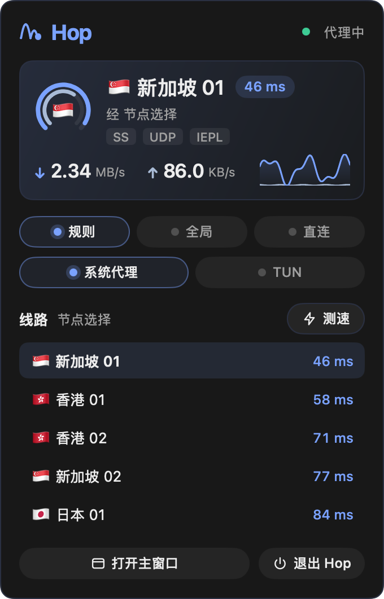

<p align="center">
  
</p>

<h1 align="center">Hop</h1>

<p align="center">
  A native macOS client for <a href="https://github.com/MetaCubeX/mihomo">mihomo</a> (Clash.Meta), written in Go. No webview, no Electron.
</p>

<p align="center">
  English · <a href="README.zh-CN.md">简体中文</a>
</p>

<p align="center">
  <a href="https://github.com/marukolibro/Hop/actions/workflows/ci.yml"></a>
  <a href="LICENSE"></a>
  <a href="go.mod"></a>
  
  <a href="https://github.com/MetaCubeX/mihomo"></a>
  <a href="https://github.com/egoist/mygo"></a>
</p>

> [!NOTE]
> Hop is in early development and has no release yet. Expect things to change.

<p align="center">
  
</p>

## Why

Hop runs its own mihomo core on `127.0.0.1` and drives it through the core's
REST API. The whole interface is drawn natively by
[MyGo](https://github.com/egoist/mygo), so it starts fast, stays light and
feels like a Mac app. It is built to sit next to another Clash client without
touching its settings, ports or files.

## Features

- **Subscriptions.** Keep several, switch between them, refresh on a schedule.
  Shows usage and expiry. Accepts Clash profiles and plain node-link lists
  (ss, vmess, vless, trojan, hysteria2, tuic, anytls, ...), converted locally
  with the core's own converter, never by a third-party service.
- **Smart rules.** Per subscription, use the provider's rules or Hop's: AI,
  streaming, Telegram, Google, Apple and Microsoft groups, region groups, and
  China-direct routing from bundled geodata that updates weekly. Add your own
  rules on top.
- **Nodes at a glance.** Groups by purpose, nodes by region, with protocol, UDP
  and latency. A live route line shows the path traffic takes.
- **System proxy and TUN.** Turn the system proxy on, or Enhanced mode (TUN)
  to carry every app's traffic through a small privileged helper installed
  once. Hop refuses when another app already holds the proxy or the routes.
- **Menu bar.** Live speed next to the icon and a panel to switch routes,
  modes and the proxy without opening the window.
- **Connections, logs and statistics.** Inspect and close connections, follow
  the core's log, and see daily traffic split into proxied and direct.
- **Stays out of the way.** Lives in the menu bar when the window is closed,
  can start at login, light and dark appearance.
- **Updates itself.** Signed updates from GitHub releases; the core can be
  upgraded from settings and rolls back if the new one fails.

<p align="center">
  
  &nbsp;
  
</p>

## Install

Runs on Apple silicon and Intel Macs (one universal app). Once a release is out:

```sh
curl -fsSL https://raw.githubusercontent.com/marukolibro/Hop/main/install.sh | sh
```

The script installs `Hop.app` into `/Applications` (or `~/Applications`)
without `sudo`. Hop then keeps itself up to date. Builds are ad hoc signed
for now, so installing through the script rather than a downloaded `.dmg`
is what lets macOS open the app.

## Privacy and safety

- Your subscription link is a credential: Hop never logs it or sends it
  anywhere but its own host.
- From a subscription, Hop only takes proxies, groups and rules. Ports, DNS,
  TUN and the controller are always Hop's own.
- The system proxy and TUN are off by default, change only when you turn them
  on, and are put back when Hop quits.
- All data stays in `~/Library/Application Support/hop/`.

## Development

Requires Go 1.27.2 or later.

```sh
scripts/fetch-mihomo.sh darwin-arm64   # bundled core and geodata, pinned and hash-checked
scripts/build-helper.sh darwin-arm64   # the TUN helper

go tool mygo dev                       # run with live reload
go vet ./... && go tool mygo vet .
HOP_MIHOMO_BINARY="$PWD/resources/darwin-arm64/bin/mihomo" go test ./...
```

`HOP_MIHOMO_BINARY` points Hop at another core while developing; with it set,
the integration tests run a real core on ports 17891 and 19091.
[AGENTS.md](AGENTS.md) describes the architecture and the rules changes follow.

### Releasing

Bump `version` in `mygo.json`, add a `## <version>` section to
`CHANGELOG.md`, commit, and push a tag:

```sh
git tag v0.1.0 && git push origin v0.1.0
```

The [release workflow](.github/workflows/release.yml) builds and signs the
app and uploads it to a draft release. Review the draft, then publish it;
installed copies update to it. `scripts/release.sh` does the same from a Mac.

## License

Hop is licensed under [GPL-3.0](LICENSE). It bundles the mihomo core
(GPL-3.0, license shipped beside the binary) and geodata from
[MetaCubeX/meta-rules-dat](https://github.com/MetaCubeX/meta-rules-dat).
