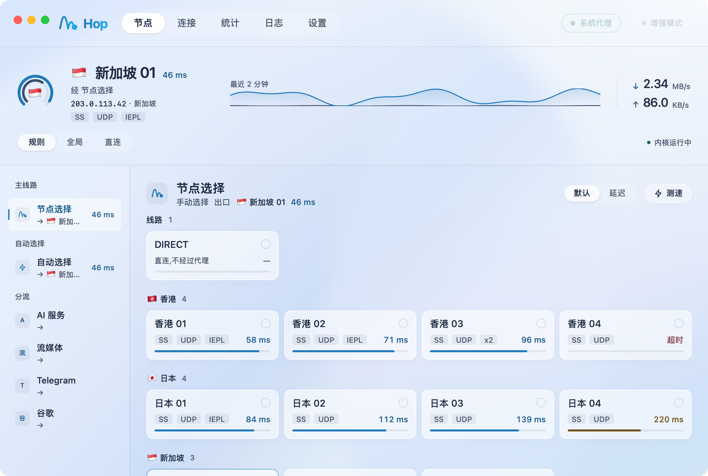
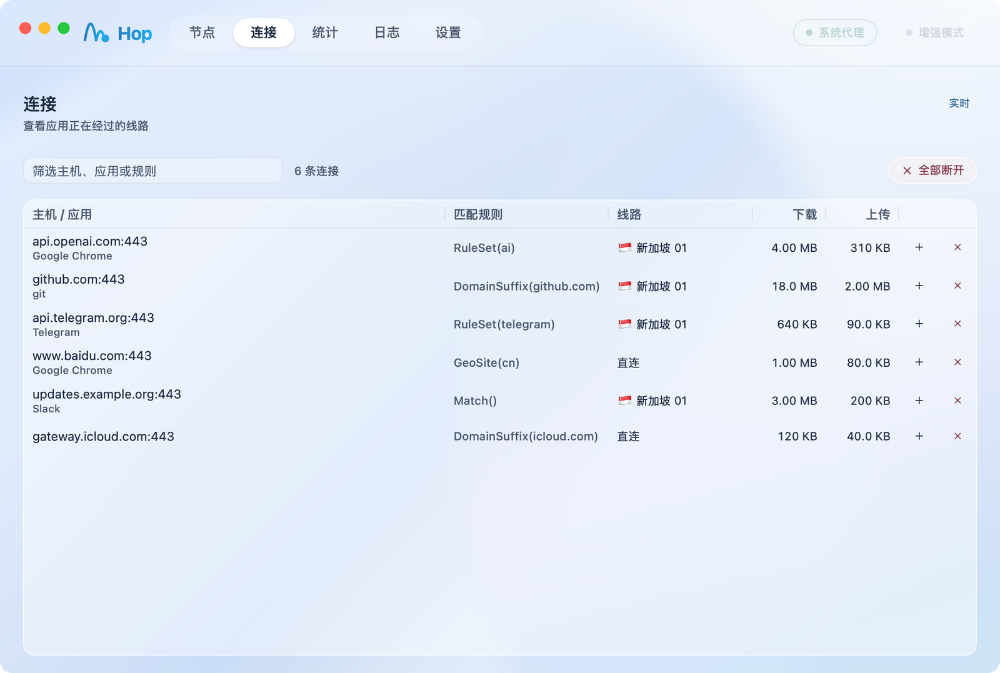
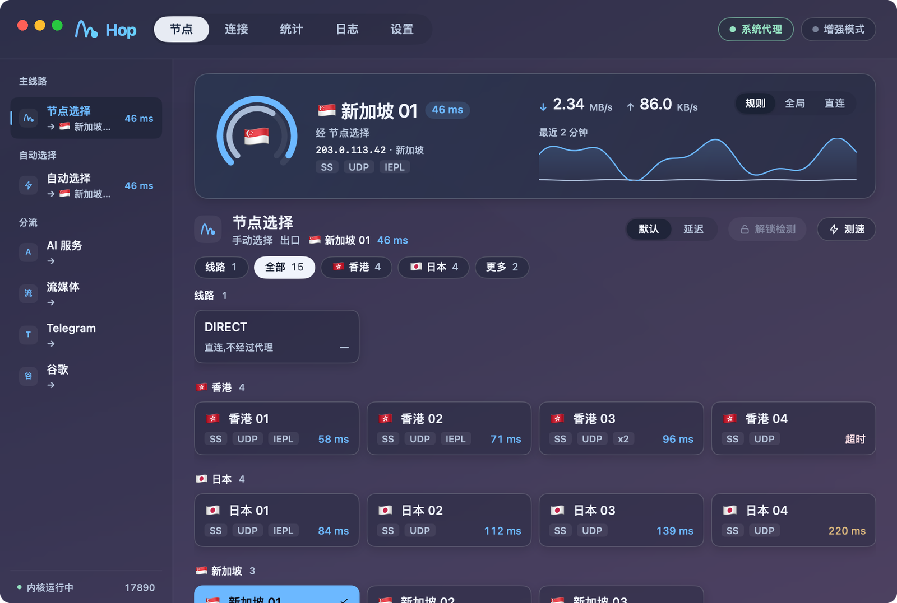
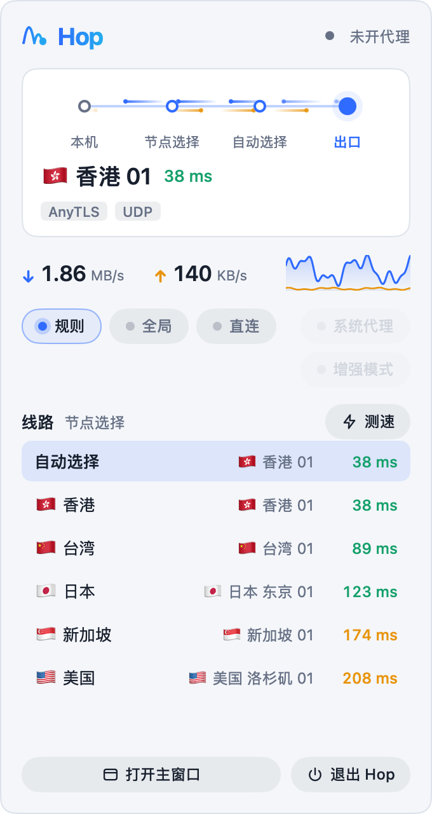
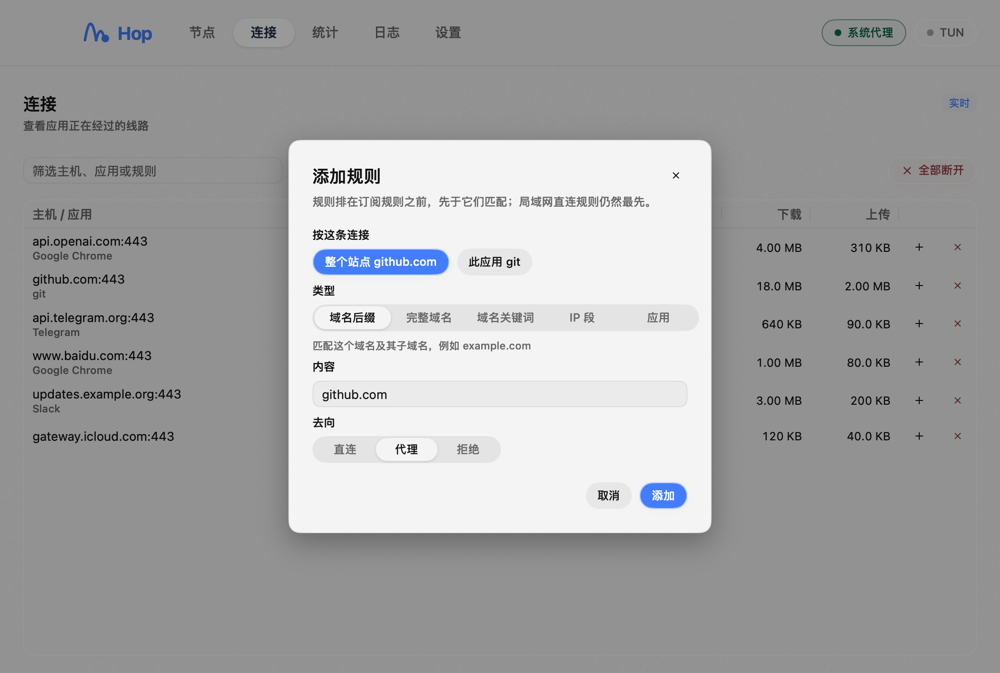

<p align="center">
  
</p>

<h1 align="center">Hop</h1>

<p align="center">
  基于 <a href="https://github.com/MetaCubeX/mihomo">mihomo</a>(Clash.Meta)内核的 macOS / Windows 原生代理客户端,用 Go 和 <a href="https://github.com/egoist/mygo">MyGo</a> 开发,界面原生绘制,没有 webview。
</p>

<p align="center">
  <a href="README.md">English</a> · 简体中文
</p>

<p align="center">
  <a href="https://github.com/marukolibro/Hop/releases/latest"></a>
  <a href="https://github.com/marukolibro/Hop/actions/workflows/ci.yml"></a>
  <a href="LICENSE"></a>
  <a href="go.mod"></a>
  
  <a href="https://github.com/MetaCubeX/mihomo"></a>
  <a href="https://github.com/egoist/mygo"></a>
</p>

<p align="center">
  <picture>
    <source media="(prefers-color-scheme: dark)" srcset="docs/screenshots/nodes-dark.png">
    
  </picture>
</p>

Hop 是 [mihomo](https://github.com/MetaCubeX/mihomo) 内核的代理客户端,算是现有客户端之外多一个选择。
它不提供任何服务器,订阅或节点链接要自己带。界面用 Go 和
[MyGo](https://github.com/egoist/mygo) 原生绘制,不走 webview,同一份代码在
macOS 和 Windows 上运行。

## 目录

[功能](#功能) · [限制](#限制) · [安装](#安装) · [快速上手](#快速上手) ·
[工作原理](#工作原理) · [隐私与安全](#隐私与安全) · [常见问题](#常见问题) ·
[开发](#开发) · [许可证](#许可证)

## 功能

### 订阅与分流

- **订阅**:保存多份订阅,随时切换,按间隔自动更新(关闭、6、12 或 24 小时),显示用量和到期时间。支持 Clash 订阅,也支持节点链接列表(ss、vmess、vless、trojan、hysteria2、tuic、anytls 等),链接在本机用内核同款转换器解析,不经过第三方转换服务。
- **本地配置**:没有订阅链接也能用。粘贴节点链接或 Clash 配置,或者选一个文件。内容保存在 Hop 内,无需刷新,原文件移动或删除都不影响。适合自建 VPS。
- **机场规则或 Hop 智能规则**:每份订阅可选。Hop 智能规则自动分出 AI、流媒体、Telegram、谷歌、苹果、微软分组和各地区组,国内直连、境外走代理,规则数据随应用自带并每周更新。
- **自己的规则**:加在所有规则最前面,可以按域名后缀、完整域名、域名关键词、IP 段或应用匹配,去向是直连、代理或拒绝。在「连接」页,每条连接末尾的 **+** 按钮会打开同一个对话框,并填好能命中这条连接的规则(整个站点、域名、应用或地址),添加规则只要点两下。
- **机场的近端入口**:订阅给节点指定了更近的入口(自带的 `hosts` 或加密 DNS)时,Hop 会使用它,和其他客户端一致;订阅里 DNS 的其他设置一概不采用。

### 节点与线路

- **节点一目了然**:策略组按用途分类,节点按地区排列,显示协议、UDP、线路标签和延迟。可以一次测速整个分组(很多节点并发),再把节点网格从订阅原顺序切换成**按延迟排序**,最快的排最前。
- **线路**:国旗在圆环中间的环形仪表(外环下载、内环上传),出口节点、经过的分组、最近两分钟走势和实时速度。
- **出口地址**:点击复制流量出口的公网 IP 和国家。出口变化时,Hop 通过自己的代理查询一次,只保存在内存里。
- **解锁检测**:在分组标题旁点「解锁检测」,Hop 会让所有分组同时去访问 ChatGPT、Netflix 和 YouTube Premium(走各分组当前用的节点),把能用的标在分组的卡片上,并显示服务看到的地区。检测走 Hop 自己的几个本机监听端口,不经过规则,也不改变你当前的线路。结果保留到退出 Hop。
- **三种模式**:规则、全局、直连,旁边说明各自的作用。

### 系统集成

- **系统代理**:窗口顶栏一个开关。其他应用已经占用系统代理时 Hop 会拒绝开启;只清除指向 Hop 自己的代理,退出时还原。
- **增强模式(TUN)**:接管所有应用的流量,由一次安装的增强组件(macOS 上是 LaunchDaemon,Windows 上是服务)以管理员权限运行内核,Hop 本身不需要这些权限。在 macOS 上,增强组件还会把系统 DNS 指向流量会进入 TUN 的解析服务器,内核停止时还原。其他 TUN 已经占用默认路由时,Hop 会拒绝开启。
- **菜单栏与托盘**:macOS 的菜单栏图标旁可以显示实时网速(可选);Windows 上同一个面板从托盘打开。不用打开主窗口就能切换线路、节点、模式和代理。
- **想怎么启动都行**:关掉窗口后留在菜单栏或托盘;可开机启动;可以复制现成的命令让终端走 Hop。

### 洞察

- **连接**:内核正在承载的每一条连接,显示应用、命中的规则和走的节点。可按主机、应用、规则或线路筛选,断开一条或全部,也可以直接加规则。
- **日志**:内核日志实时显示,可按级别筛选。
- **统计**:今天、本月和最近 30 天,区分代理和直连,并按订阅统计本月流量。

### 外观

- **玻璃**:macOS 和 Windows 11 上是磨砂玻璃窗口,背景默认海蓝(或暮紫);Windows 11 的主窗口用 Mica,面板用 Acrylic;Windows 10 是同样布局的纯色版。浅色、深色或跟随系统,与主题互不影响。macOS 上可以用滑块调节窗口通透度。
- **克制的动效**:动效只表现变化:开关滑动、数字滚动、工作进行时转圈。

<p align="center">
  <picture>
    <source media="(prefers-color-scheme: dark)" srcset="docs/screenshots/stats-dark.png">
    
  </picture>
</p>

<p align="center">
  
  
</p>

<p align="center">
  <picture>
    <source media="(prefers-color-scheme: dark)" srcset="docs/screenshots/menubar-dark.png">
    
  </picture>
  &nbsp;
  
</p>

### 更新

- **Hop 自己更新**:从 GitHub 发布获取更新。每个更新都有签名,应用安装前会校验签名;能的话只下载相对你当前版本变化的部分。
- **内核可以在设置里升级**:下载的文件对照 GitHub 公布的校验值检查,新内核启动失败会自动回退;随应用自带的内核随时可以恢复。
- **规则数据**(规则用到的数据库)每周更新一次,也可以手动更新。

## 限制

Hop 还很年轻,而且有意保持小。界面目前只有中文;没有 Linux 版;没有配置脚本或合并文件,所以能在多大程度上改写机场的配置,是被有意限制的;macOS 应用是本机临时签名(ad hoc),Windows 安装包没有代码签名,所以第一次运行需要你确认一下(见[安装](#安装))。

## 安装

| 平台 | 支持 | 方式 |
| --- | --- | --- |
| macOS | Apple 芯片和 Intel(同一个通用安装包) | 下面的安装脚本 |
| Windows | x64,Windows 10 和 11(玻璃效果需要 Windows 11 22H2 或更新) | 从[最新发布](https://github.com/marukolibro/Hop/releases/latest)下载 `Hop Setup <版本> amd64.exe` |

不支持 Linux。

### macOS

```sh
curl -fsSL https://raw.githubusercontent.com/marukolibro/Hop/main/install.sh | sh
```

脚本把 `Hop.app` 装到 `/Applications`(没有写权限时装到 `~/Applications`),不需要 `sudo`,会检查下载文件的大小、版本和代码签名,装好后打开它。再运行一次就会装上新版本。目前的安装包是本机临时签名(ad hoc),用这个脚本安装,而不是下载 `.dmg`,macOS 才能正常打开它。

### Windows

从[最新发布](https://github.com/marukolibro/Hop/releases/latest)下载 `Hop Setup <版本> amd64.exe` 并运行。安装包还没有代码签名,第一次运行时 Windows SmartScreen 会要你确认:点「更多信息 → 仍要运行」。

之后两个平台的 Hop 都会自己保持最新。

## 快速上手

1. **添加订阅**:打开节点页,在订阅栏添加:粘贴机场给你的链接,或者来源选「本地配置」,粘贴节点链接或 Clash 配置。
2. **选择规则**:沿用机场规则,或使用 Hop 智能规则。
3. **选线路**:在侧栏选一个分组,测速,点一个节点(也可以把节点网格切换成按延迟排序)。
4. **打开开关**:顶栏的系统代理开关会让应用走 Hop;增强模式第一次打开时会请你安装增强组件。
5. **按需调整**:在「设置」或任意一条连接里添加自己的规则,选择主题和外观,决定要不要开机启动。

不认系统代理的应用,可以把代理设为混合端口 `127.0.0.1:17890`(HTTP 或 SOCKS5);也可以在「设置 → 终端代理」复制现成的终端命令。

## 工作原理

```
 Hop(MyGo 原生界面)── REST / WebSocket ──▶ mihomo 内核(本机回环)
        │                                          ▲
        └── 增强组件(仅 TUN)───────────────────────┘ 以 TUN 运行内核
```

- Hop 把自己的 mihomo 作为伴随进程启动,崩溃时按退避策略重启,并通过控制接口控制它。
- 内核的配置由 Hop 自己生成。订阅里只取节点、策略组和规则(白名单);端口、DNS、TUN 和控制接口始终由 Hop 决定。
- 增强模式打开时,由增强组件运行内核,Hop 把配置发给那个内核。

| 内容 | 位置 |
| --- | --- |
| 混合(HTTP 和 SOCKS5)代理 | `127.0.0.1:17890` |
| 内核控制接口 | `127.0.0.1:19090` |
| 内核 DNS,仅用于让节点域名走订阅指定解析的订阅 | `127.0.0.1:17853` |
| 解锁检测专用的监听端口,每个只走正在检测的那个分组 | `127.0.0.1:17900`–`17907` |
| 数据(权限 0600) | macOS:`~/Library/Application Support/hop/`;Windows:`%AppData%\hop` |

这些端口都避开了其他 Clash 客户端常用的端口。

## 隐私与安全

- 订阅链接等同于密码:Hop 不会把它写进日志,也只发给订阅自己的服务器。本地配置的内容里有节点密码,同样处理。
- 链接在本机转换,不会有转换服务看到它们。
- Hop 不读取、不改动其他 Clash 客户端的文件和进程;除了通过自己的增强组件处理 TUN,它不会改 DNS 和路由。
- 系统代理和增强模式默认关闭,只在你打开时才改动,退出 Hop 时还原。
- 出口地址通过 Hop 自己的代理向 Cloudflare(`1.1.1.1/cdn-cgi/trace`)查询一次,只保存在内存中,不写入磁盘或日志。
- 所有数据只保存在本机上面列出的目录里。

## 常见问题

- **macOS 提示应用已损坏或来自未知开发者**:用安装脚本安装,而不是打开下载的 `.dmg`。
- **Windows SmartScreen 拦截安装包**:安装包还没有代码签名,点「更多信息 → 仍要运行」。
- **增强模式打不开**:另一个 VPN 或 Clash 客户端占着默认路由,先关掉它的 TUN。Hop 不会抢路由。
- **端口和别的客户端冲突**:Hop 自己用 `17890`、`19090`、`17853` 和 `17900`–`17907`,和其他客户端不重叠,可以同时运行。
- **延迟偏高**:订阅指定了近端入口时 Hop 会采用;换订阅或节点后重新测速。

## 开发

需要 Go 1.27.2 或更高版本。

```sh
scripts/fetch-mihomo.sh darwin-arm64   # 下载随应用自带的内核和规则数据(固定版本并校验哈希)
scripts/build-helper.sh darwin-arm64   # 构建增强组件

go tool mygo dev                       # 开发模式,保存即热重载
go vet ./... && go tool mygo vet .
HOP_MIHOMO_BINARY="$PWD/resources/darwin-arm64/bin/mihomo" go test ./...
```

在 Windows 上,两个脚本都用 `windows-amd64`(在 Git Bash 里运行),内核用 `mihomo.exe`。

- **开发版可以和已安装的 Hop 同时运行**:`go tool mygo dev` 是独立的一份:端口 `17892`、`19092` 和 `17855`,数据目录 `hop-dev`,一开始没有订阅,也不会访问特权增强组件——增强组件整台机器只有一个,属于已安装的 Hop。
- `HOP_MIHOMO_BINARY` 可以让开发时改用别的内核;设置后,集成测试会在 17891 和 19091 端口启动真实内核。
- 为其他平台构建:`go tool mygo build -platform windows/amd64`。

```
main.go               把所有部分接起来
config/               实例(发布版和开发版):端口、数据目录、内核的选择
cmd/hop-helper/       特权增强组件(TUN)
internal/handler/     原生界面
internal/service/     业务逻辑:视图、规则、订阅、TUN、更新
internal/repository/  内核进程和客户端、配置存储、增强组件的客户端、
                      系统代理、路由表、订阅、规则数据
internal/model/       共用的类型
scripts/              下载内核、构建增强组件、发布、诊断 TUN
```

架构和改代码要遵守的规则见 [AGENTS.md](AGENTS.md)。

### 发布

改 `mygo.json` 里的 `version`,在 `CHANGELOG.md` 里加 `## <版本>` 一节,提交后推送标签:

```sh
git tag v0.3.0 && git push origin v0.3.0
```

[发布流程](.github/workflows/release.yml)会编译并签名 macOS 应用和 Windows 安装包,连同更新清单一起上传成草稿发布。检查草稿后点发布,已安装的 Hop 就会更新过去。在 Mac 上用 `scripts/release.sh` 可以构建 macOS 版本。

## 许可证

Hop 以 [GPL-3.0](LICENSE) 发布。随应用分发的 mihomo 内核同为 GPL-3.0(许可证随内核一起附带),规则数据来自 [MetaCubeX/meta-rules-dat](https://github.com/MetaCubeX/meta-rules-dat)。
